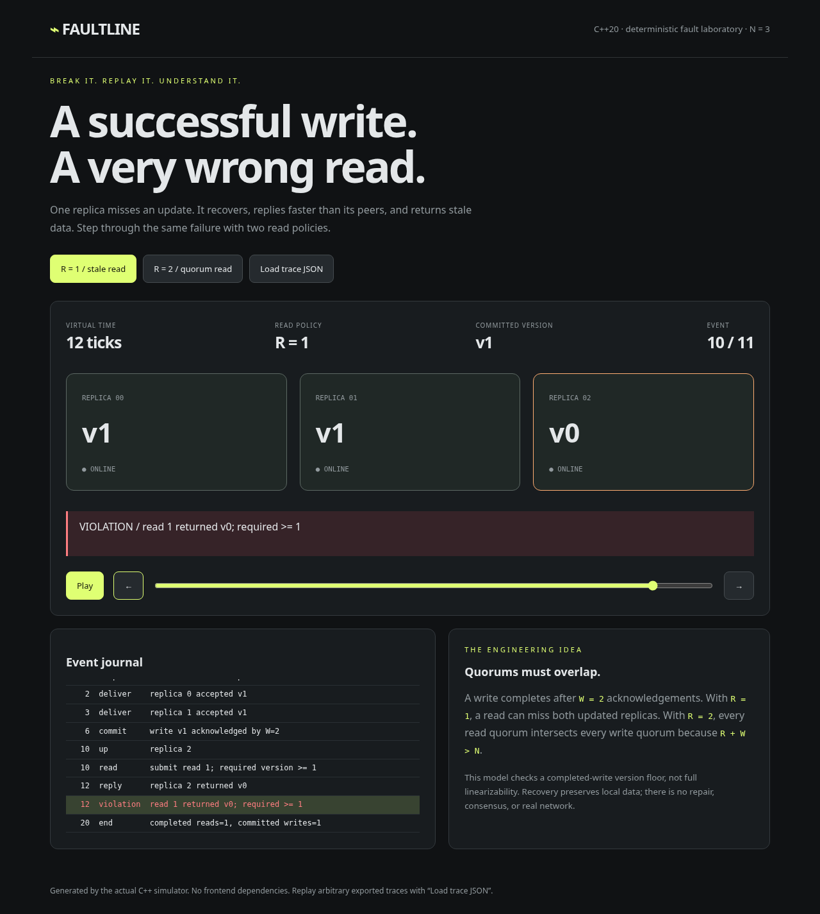

# Faultline

**Find a distributed-systems failure. Shrink it. Replay every event.**

A C++20 fault laboratory for a three-replica register. Faultline explores deterministic schedules, discovers stale reads after replica recovery, reduces a failing scenario, and exports a trace you can step through in a dependency-free browser UI.



```text
$ ./build/faultline search 0 1000 1 build/counterexample
seed=3 actions=81 minimized=7
$ ./build/faultline replay build/counterexample.fl 1 build/trace.json
reads=1 commits=1 violated=1
```

This reproducible search reduces an 81-action failure to seven actions. A violation deliberately exits with status **1**, suitable for a test runner.

## Try it in two minutes

Requirements: GCC 11+ or a C++20-capable Clang, GNU Make. Python 3 is needed for CLI tests and fixture generation. The simulator itself has **no third-party dependencies**.

```sh
make
make test
./build/faultline replay scenarios/stale-read.fl 1 build/unsafe.json
# Expected exit 1: a stale read is detected.
./build/faultline replay scenarios/stale-read.fl 2 build/safe.json
# Expected exit 0: both required operations completed without a violation.
```

Open [`web/index.html`](web/index.html) in your browser. It works directly from disk: bundled traces are generated by the C++ engine, with no server or frontend build. Switch between R=1 and R=2, scrub the timeline, or import `build/unsafe.json`.

## What makes this interesting

- **Reproducible simulation:** virtual time, stable sequence numbers for equal-time events, and a seeded `std::mt19937` generator. Replays produce identical JSON bytes; no threads or sleeps.
- **Actual failure discovery:** bounded randomized searches exercise isolation, recovery, writes, reads, and network delivery. The checked invariant compares a completed read with the latest write acknowledged before that read began.
- **Counterexample reduction:** repeated action deletion finds a failure for which removing any one remaining action loses the violation. This is deletion minimal, not a globally shortest trace.
- **A controlled comparison:** W=2/R=1 exposes stale reads; W=2/R=2 prevents this particular invariant violation through quorum intersection and monotonic replica versions.
- **Inspectable evidence:** a small scenario language, JSON snapshots after each event, an interactive journal, regression tests, and sanitizer validation.

## The six-line counterexample

```text
down 2      # Isolate the fastest replica.
write 42    # Replicas 0 and 1 receive version 1.
tick 10     # Both acknowledge: the write is committed.
up 2        # Replica 2 recovers with its old version 0.
read        # R=1 accepts its fast stale reply; R=2 also waits for replica 0.
tick 10     # Deliver replies and check the invariant.
```

With N=3 and W=2, `R + W > N` guarantees that read and write quorums overlap. Choosing the greatest version among the first R responses is essential. Waiting for a majority is an availability tradeoff: with only one reachable replica, R=2 cannot finish. An unfinished read is reported as unfinished, never counted as a passing read.

## CLI

```sh
./build/faultline --help
./build/faultline search 0 1000 1 build/failure
# Writes failure.original.fl, failure.fl and failure.json on the first violation.
./build/faultline replay build/failure.fl 1 build/replayed.json
./build/faultline search 0 10000 2 build/quorum
```

`replay FILE R [JSON]` uses R=1 or R=2. `search FIRST_SEED COUNT R PREFIX` explores up to COUNT seeds and stops at the first violation. The prefix directory must already exist. Exit statuses: **0** no violation; **1** violation; **2** malformed input or I/O error. A zero-violation replay can still have zero completed operations; inspect the printed counts.

Scenario commands: `write INTEGER`, `read`, `down NODE`, `up NODE`, `tick INTEGER`; nodes are 0..2, ticks are 0..1,000,000. Blank lines and `#` comments are supported. Only `tick` advances time; pending events are **not** automatically drained at end-of-file.

## Validation

```sh
make test       # Model regression/property tests + CLI/I/O tests
make sanitize   # Rebuild and run the same suite under ASan and UBSan
make demo       # Regenerate browser examples from actual simulator results
```

The model suite covers 2,000 seeds, checks that safe reads actually complete, verifies counterexample deletion minimality, exercises unavailable quorums and dropped in-flight requests, and rejects malformed inputs. The CLI suite checks exit codes, JSON parsing, and byte-identical replay of saved counterexamples.

Optional UI checks:

```sh
python3 -m pip install playwright==1.62.0
python3 -m playwright install chromium
python3 tests/browser.py
```

The UI test also accepts system Chromium (`CHROMIUM_PATH=/path/to/chromium`); in that case no browser download is needed.

See [architecture and limits](docs/architecture.md), [Russian walkthrough](docs/README.ru.md), and [design decisions](docs/decisions.md).

## Scope and honesty

This is a small model-checking-inspired simulator, not a production database, consensus implementation, or exhaustive model checker. Its invariant is weaker than linearizability. Random searches are evidence, not a proof; quorum intersection explains why the safe policy works **under the documented model assumptions**. It has no real sockets, persistence, anti-entropy, clock-skew handling, or multiprocess execution.

To explore the design, reproduce the failure, inspect the event ordering, and compare the quorum policies. See the architecture document for the model assumptions and limitations.

## License

MIT — see [LICENSE](LICENSE).
