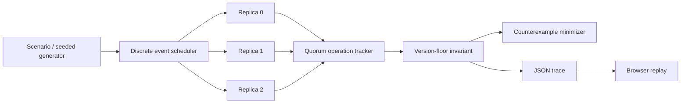

# Architecture and model contract

## Execution

The driver submits operations at the current virtual time. Requests take 2, 3, and 1 ticks to replicas 0, 1, and 2 respectively; replies take the same time. The priority queue orders events by `(time, sequence)` so ties have a defined order. `tick T` processes events up to and including `now + T`. Internal times and sequence numbers use 64-bit integers.

A write has a driver-issued, strictly increasing version. A replica only accepts a newer version. The driver considers a write committed when it receives two acknowledgements and records the maximum committed version. Multiple operations may be in flight. Values are integer payloads; the checked property is about versions.

A read captures the committed version **at submission time** as its floor. It returns the maximum version among the first R replies. Responses arriving after completion are ignored. A violation is `returned_version < captured_floor`.

Isolation (`down`) drops requests sent to, or delivered at, an isolated replica. Recovery (`up`) restores connectivity without catching up missing data. Replica memory survives isolation. Replies already sent remain deliverable even if the originating replica later goes down: a reply in the network is independent of the sender. This is deliberate, not a model of a crash erasing memory.

## Why R=2 satisfies this property

Every committed write was accepted by two replicas before its acknowledgements reached the driver. Every completed R=2 read samples two replicas after the read was submitted. These sets intersect in a three-node system. The intersecting replica's version cannot decrease, so the maximum read version is at least the captured committed floor. Concurrent later writes may cause a read to return a higher version; that is permitted.

This argument depends on version monotonicity and retained state. It does not establish full linearizability: an uncommitted write may be observed by one read and missed by a later read. There is no read repair/write-back phase. General atomic-register semantics would require a stronger algorithm and history checker.

## Search and reduction

Each seed creates 80 actions plus a final 20-tick drain. Randomness uses raw `mt19937` outputs modulo small bounds for stable generation without implementation-specific distribution mappings. This is not statistically unbiased sampling or exhaustive exploration. Network latencies remain fixed; action timing and faults vary.

The reducer deletes one action at a time and reruns from a fresh simulator. It repeats until a full pass removes nothing, giving a deletion-minimal witness. Cost is roughly quadratic in action count times replay cost; the CLI's fixed 81-action inputs keep this bounded. Independent seeds can be sharded by the caller.

The simulator is a one-run object. Queued callbacks capture it; do not move it while events are pending. Public CLI inputs are validated by the scenario parser.

## Extending the project

Useful next experiments: configurable latencies, message loss distinct from node isolation, persistent crash recovery, read repair, explicit invocation/response histories, and a bounded linearizability checker. Add a regression scenario and a property test with each change; do not simply weaken the invariant when a new failure appears.
